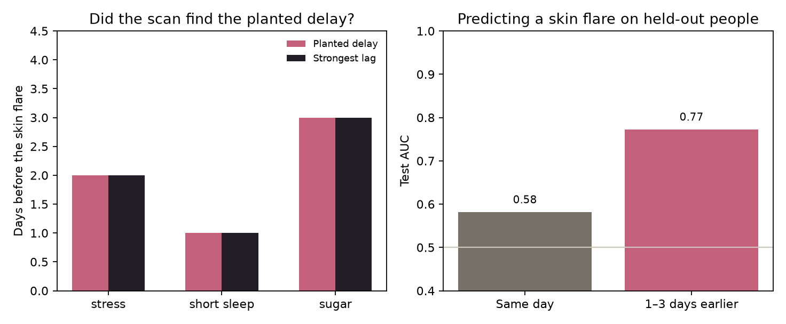

# Flare lag

Same-day notes blame the wrong thing. Here a flare means a skin flare, the kind in psoriasis, eczema, or acne. It often shows up one to three days after stress, short sleep, or sugar. This project checks whether a model can find that delay when the answer is known.

The diaries are simulated. Nothing here is a medical record, and nothing here diagnoses anyone.

## What is planted

400 people, 120 days each. Three causes, with a fixed delay:

| Signal | Delay before the skin flare |
| --- | --- |
| Stress | 2 days |
| Short sleep | 1 day |
| Sugar | 3 days |

Steps and screen time do nothing. Cream is applied because a skin flare is already happening, so it lines up with the same day. About 8% of the habit values are missing. A skin flare also makes the next day more likely to flare, the way a plaque does not clear overnight.

## What the run found

From `python -m flare_lag` with seed 7. Numbers are in `results/summary.json`.

A same-day correlation blames the cream (r = 0.70). The cream did not cause the skin flare.

Looking back up to 4 days, the strongest lag matches the planted delay for all three causes:

| Signal | Planted | Strongest lag | Correlation |
| --- | --- | --- | --- |
| Stress | 2 days | 2 days | 0.42 |
| Short sleep | 1 day | 1 day | 0.06 |
| Sugar | 3 days | 3 days | 0.21 |

Short sleep is the weak one. The day is right, and the correlation is small, because a skin flare carries into the next day and sleep does not swing as hard as stress.

Predicting a skin flare for people the model has not seen:

| Features | Test AUC | Average precision |
| --- | --- | --- |
| Same day only | 0.58 | 0.52 |
| 1 to 3 days earlier | 0.77 | 0.74 |

About 45% of days are skin-flare days, so 0.50 would be a coin flip. The lagged logistic regression puts the largest weights on stress two days earlier and sugar three days earlier.



## Run it

```bash
python -m venv .venv
source .venv/bin/activate
pip install -e ".[dev]"
pytest
python -m flare_lag
```

`results/summary.json` and `results/lag_vs_sameday.png` are rewritten each run.

## What this does not show

The delays were written into the simulator. Recovering them means the method can find a delay that was put there. It does not prove that stress, sleep, or sugar work this way for a real person. A real diary is shorter, messier, and has more than one thing changing at once.

Cream is the cautionary example. It is the strongest same-day correlation and it is a consequence, not a cause.
